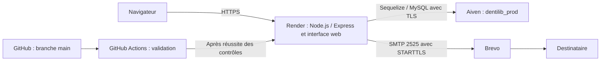

# DentiLib — Guide de déploiement

## 1. Objet et périmètre

Ce document décrit l’architecture, les prérequis, la configuration et les opérations
nécessaires pour mettre en ligne DentiLib, vérifier son fonctionnement et préparer
ses mises à jour. Il regroupe également les procédures de validation et de CI utiles
au déploiement.

La version décrite est une démonstration utilisant des données fictives. La mise en
ligne, la connexion administrateur et la réception d’un e-mail ont été vérifiées.
Les limites de sécurité et les procédures d’exploitation restant à valider sont
précisées en fin de document.

Application : **https://dentilib-d50z.onrender.com**.

## 2. Architecture et services



| Composant | Rôle |
| --- | --- |
| Node.js et Express | Serveur HTTP, API et distribution des fichiers de l’interface dans `public/` |
| Sequelize et mysql2 | Accès à la base relationnelle MySQL |
| Render | Hébergement de l’application, installation, démarrage et HTTPS public |
| Aiven | Hébergement MySQL et certificat CA pour la connexion TLS |
| Brevo | Relais SMTP pour les e-mails de l’application déployée |
| GitHub | Gestion du code et intégration des modifications par pull request |
| GitHub Actions | Exécution des tests dans un environnement temporaire avant déploiement |
| DBeaver | Administration de MySQL et initialisation manuelle des tables |
| Mailpit | Capture locale des e-mails de test ; ne distribue pas les messages réels |

Render termine la connexion HTTPS du navigateur. Express utilise HTTP à l’intérieur
de la plateforme et écoute sur le port fourni par Render. La connexion vers Aiven
est protégée séparément par TLS ; le SMTP Brevo utilise STARTTLS obligatoire.

### Séparation des environnements

| Environnement | Base | Application | E-mails |
| --- | --- | --- | --- |
| Développement local | `dentilib` | `http://localhost:3000` | SMTP défini dans le `.env` local |
| Tests locaux | `dentilib_test` | `http://localhost:3001` | Mailpit : SMTP 1025, interface 8025 |
| CI GitHub Actions | `dentilib_test`, dans un service temporaire | `http://localhost:3001` sur la machine CI | Mailpit temporaire |
| Démonstration déployée | `dentilib_prod`, sur Aiven | URL publique HTTPS Render | Brevo |

Les bases locale et distante sont indépendantes, sans synchronisation automatique.
Les campagnes automatisées ne doivent pas cibler `dentilib_prod`.

## 3. Prérequis et fichiers de référence

Préparer les accès au dépôt GitHub, au service Render, au service MySQL Aiven et
au compte Brevo. Utiliser Node.js 24 pour reproduire l’environnement de la CI.
Un client MySQL tel que DBeaver est nécessaire pour l’initialisation manuelle.

| Fichier | Utilité |
| --- | --- |
| `package.json` et `package-lock.json` | Commandes et dépendances de l’application |
| `server.js` | Démarrage après connexion MySQL, port et origine CORS |
| `config/sequelize.js` | Connexion MySQL et vérification TLS |
| `utils/mailer.js` | Transport SMTP selon l’environnement |
| `sql/create_tables.sql` | Création des cinq tables ; script destructif à réserver à l’initialisation |
| `sql/jeu_essai.sql` | Données fictives de démonstration |
| `test/resetDatabase.js` | Réinitialisation protégée de la base de test locale |
| `.github/workflows/tests.yml` | Workflow de validation automatisée |

Les secrets sont renseignés dans Render. Le `.env` local est ignoré par Git ;
il ne doit pas être copié dans le dépôt ou dans les rapports.

## 4. Préparer MySQL sur Aiven

### 4.1. Créer le service et la connexion d’administration

1. Créer un service MySQL Aiven et attendre sa disponibilité.
2. Relever l’hôte, le port et les identifiants de connexion fournis par Aiven.
3. Télécharger le certificat CA du service.
4. Dans DBeaver, créer une connexion distincte de la connexion MySQL locale.
5. Renseigner les paramètres Aiven et le certificat CA dans la configuration SSL,
   puis activer la vérification du certificat et de l’identité du serveur.
6. Tester la connexion, puis créer la base `dentilib_prod` et la sélectionner.

Le nom du champ SSL dans l’outil désigne la configuration de la connexion chiffrée.
TLS assure le chiffrement et l’intégrité des échanges. Le certificat CA permet de
vérifier le certificat présenté ; le nom d’hôte doit aussi correspondre au serveur attendu.
La configuration DBeaver ne configure pas automatiquement Sequelize.

### 4.2. Initialiser une base vide

Dans l’éditeur SQL associé à la connexion Aiven, exécuter :

```sql
CREATE DATABASE IF NOT EXISTS dentilib_prod
  CHARACTER SET utf8mb4
  COLLATE utf8mb4_unicode_ci;

USE dentilib_prod;
```

Exécuter ensuite une copie de `sql/create_tables.sql` dont les instructions
`CREATE DATABASE` et `USE` ciblent `dentilib_prod`, avec **Execute SQL Script**.
Les fichiers d’origine peuvent garder leur cible locale `dentilib`.

Vérifier la présence des cinq tables :

- `utilisateurs` ;
- `actes` ;
- `actes_prothesiste` ;
- `fiches_travaux` ;
- `actes_fiche`.

Pour cette démonstration seulement, exécuter une copie de `sql/jeu_essai.sql`
avec `USE dentilib_prod`, puis vérifier les comptes administrateur, Marie Martin
et Paul Durand, ainsi que les associations et les données de démonstration.
Les identifiants du jeu d’essai sont publics : ils ne conviennent pas à un usage réel.

**Ne pas rejouer le script de création sur une base à conserver : il supprime les
tables et leurs données.** L’initialisation et le jeu d’essai ne font pas partie
du démarrage normal. Les évolutions futures du schéma nécessitent une procédure
de migration et une sauvegarde préalable.

## 5. Configurer Render et les services externes

### 5.1. Service web

Configurer le service Render avec le dépôt DentiLib, la branche `main` et les commandes
existantes :

| Paramètre | Valeur |
| --- | --- |
| Build Command | `npm install` |
| Start Command | `node server.js` |
| Branche déployée | `main` |
| Déploiement automatique retenu | `After CI Checks Pass` |

`npm install` installe les dépendances lors du build. `node server.js` démarre
l’application. La CI utilise séparément `npm ci`, qui s’appuie sur le fichier de
verrouillage pour reproduire l’installation.

L’ancienne configuration MongoDB (`DB_URL`) n’est pas utilisée par la connexion
Sequelize actuelle. Configurer les paramètres MySQL ci-dessous.

### 5.2. Certificat CA et variables d’environnement

Dans **Environment → Secret Files**, ajouter le certificat CA Aiven sous le nom
`aiven-ca.pem`. Le chemin utilisé par l’application est `/etc/secrets/aiven-ca.pem`.

Dans **Environment**, renseigner :

| Variable | Valeur ou fonction |
| --- | --- |
| `NODE_ENV` | `production` |
| `DB_HOST` | Hôte MySQL fourni par Aiven |
| `DB_PORT` | Port MySQL fourni par Aiven |
| `DB_NAME` | `dentilib_prod` |
| `DB_USER` | Utilisateur MySQL Aiven |
| `DB_PASSWORD` | Mot de passe MySQL Aiven |
| `DB_SYNC` | `false` : pas de synchronisation automatique des tables |
| `DB_SSL_CA_PATH` | `/etc/secrets/aiven-ca.pem` |
| `CORS_ORIGIN` | `https://dentilib-d50z.onrender.com` ; adapter si le domaine change |
| `JWT_SECRET` | Secret de signature propre à la production |
| `SMTP_HOST` | `smtp-relay.brevo.com` |
| `SMTP_PORT` | `2525` |
| `SMTP_USER` | Identifiant SMTP fourni par Brevo |
| `SMTP_PASS` | Clé SMTP Brevo |
| `EMAIL_FROM` | Adresse d’expédition validée dans Brevo |

Render fournit `PORT`. Ne pas renseigner de `DB_SOCKET` local pour la connexion distante.
Le certificat CA est un certificat de confiance, pas une clé privée.

À la configuration initiale, générer le secret JWT dans un terminal :

```bash
openssl rand -hex 32
```

La commande produit 32 octets aléatoires sous forme de 64 caractères hexadécimaux.
Renseigner le résultat dans `JWT_SECRET` sans le publier. Ce secret signe les jetons,
mais ne chiffre pas leur contenu. Son remplacement invalide les jetons existants.

Dans `config/sequelize.js`, la production exige un certificat CA. La connexion utilise
`rejectUnauthorized: true` et `verifyIdentity: true`. Un certificat absent, illisible
ou non valide empêche le démarrage ; ne pas désactiver les vérifications pour contourner
une erreur de connexion.

### 5.3. Configurer Brevo

1. Valider l’adresse d’expédition dans Brevo.
2. Générer une clé SMTP et relever l’identifiant SMTP.
3. Renseigner les variables SMTP dans Render et utiliser le port `2525` retenu
   pour ce déploiement, à la place du port Gmail `587` local.
4. Renseigner `EMAIL_FROM` avec l’expéditeur validé, distinct de l’identifiant SMTP.
5. Appliquer la configuration en redéployant le service.

Le transport hors tests dans `utils/mailer.js` utilise `secure: false` et
`requireTLS: true` : la connexion doit passer au chiffrement par STARTTLS.
En environnement `test`, le transport cible exclusivement Mailpit local.

Les e-mails de création de compte contiennent l’identifiant et un lien de contact
administrateur, sans mot de passe. La remise du mot de passe initial reste manuelle,
par un canal distinct ; le lien de contact n’est pas un lien d’activation.

## 6. Valider avant la mise en ligne

### 6.1. Stratégie et couverture

Les validations combinent des scénarios nominaux, alternatifs et négatifs.
Les tests API appellent le vrai serveur et MySQL ; ils ne constituent pas une suite
unitaire isolée. Les tests navigateur vérifient les effets métier visibles.

| Ensemble | Périmètre et inventaire |
| --- | --- |
| Jest / Supertest | 27 tests : 12 d’authentification, 8 d’administration, 7 de sécurité et validation |
| Cypress | 23 tests dans 5 fichiers, dont 1 réinitialisation et 22 tests de parcours ou de validation |
| Postman / Newman | 17 requêtes et 31 assertions sur un parcours API des trois rôles |
| Mailpit | Vérification manuelle des e-mails capturés sans distribution réelle |

Les fonctionnalités vérifiées comprennent la gestion et l’association des comptes,
les erreurs de saisie, les JWT absents ou invalides, les restrictions de rôle,
le refus de lecture ou modification d’une fiche étrangère et la conservation de ses
données après un refus. Les parcours incluent création et envoi des fiches, réception,
passage à `EN_COURS`, annulation de suppression et persistance après rechargement.

Les fichiers de référence sont `test/userAuth.test.js`, `test/userAdmin.test.js`,
`test/securityAccess.test.js` et les cinq fichiers de `cypress/e2e/` listés ci-dessous.
La collection API est `DentiLib.postman_collection.json`, avec
`dentilibEnv.postman_environment.json`.

### 6.2. Exécuter les campagnes locales

Prérequis : dépendances installées, MySQL local démarré, configuration locale renseignée
et cinq tables présentes dans `dentilib_test`. Toutes les commandes npm partent de
la racine du projet.

**Terminal 1 — démarrer Mailpit :**

```bash
mailpit
```

Cette commande suppose la fonction locale déjà configurée dans `~/.zshrc`.
À défaut, sur le poste utilisé pour le projet :

```bash
"$HOME/Documents/Projects_dev/Outils/mailpit/mailpit" --listen 127.0.0.1:8025 --smtp 127.0.0.1:1025
```

L’interface est accessible sur **http://127.0.0.1:8025/**.

**Terminal 2 — démarrer et laisser ouvert le serveur de test :**

```bash
npm run start:test
```

Cette commande sélectionne `dentilib_test` et le port 3001 sans remplacer la base
principale du `.env`.

**Terminal 3 — exécuter les campagnes successivement :**

```bash
npm run test:api
```

La commande réinitialise la base de test, puis lance Jest/Supertest sur le port 3001.

```bash
npm run cypress:open
```

Dans Cypress, exécuter les fichiers dans cet ordre :

1. `00-reset-db.cy.js` ;
2. `admin-users.cy.js` ;
3. `dentist-worksheet.cy.js` ;
4. `prothesist-worksheet.cy.js` ;
5. `error-messages.cy.js`.

Ne pas réinitialiser entre ces fichiers : les parcours partagent les comptes et
le catalogue préparés par l’administration. Terminer la campagne avant d’exécuter :

```bash
npm run test:newman
```

Cette commande réinitialise la base, lance la collection et génère
`newman/rapport-api.html` et `newman/rapport-api.json`. Pour ouvrir le rapport sur macOS :

```bash
open newman/rapport-api.html
```

La réinitialisation indépendante reste disponible :

```bash
npm run db:test:reset
```

La fonction `resetTestDatabase()` de `test/resetDatabase.js` supprime les données,
pas les tables. Elle refuse un environnement autre que `test`, une base autre que
`dentilib_test` ou un hôte MySQL non local. Ces contrôles ne remplacent pas les droits
SQL limités à la base de test. Ne pas lancer plusieurs campagnes simultanément.

### 6.3. Résultats et décision de validation

Les exécutions locales ont été confirmées réussies au cours de la validation :
18 tests API initiaux, puis 2 contrôles JWT et 7 compléments ; 20 tests Cypress
initiaux, puis 3 compléments. La CI Jest/Cypress a ensuite été confirmée réussie.
Le résultat Newman transmis contient 17 requêtes et 31 assertions sans échec.
Ces nombres mesurent des éléments différents et ne doivent pas être additionnés.

Les anomalies rencontrées ont porté notamment sur des assertions visant un ancien
message, une notification temporaire, un libellé anglais de doublon d’acte et une
réponse conditionnelle HTTP 304. Les contrôles ont été alignés sur le résultat métier,
le message français a été corrigé et le test de rechargement a été adapté avant retest.

Pour autoriser une nouvelle mise en ligne, vérifier la réussite des campagnes prévues
et conserver les résultats avec le commit, la date et l’environnement. Une campagne
verte valide le périmètre testé ; elle ne supprime pas les limites connues.

**Limites de validation :** le cycle des fiches n’est pas testé jusqu’à la finalisation
et au paiement ; les tests de charge et de performance ne sont pas réalisés.
La persistance des tarifs, le PDF, les JWT expirés et la compatibilité entre tous
les navigateurs ne sont pas couverts de manière complète. Aucun pourcentage de
couverture du code n’a été mesuré.

## 7. Mise en ligne et intégration continue

### 7.1. Proposer une évolution

Partir d’un état local vérifié et conserver les modifications en cours avant de changer
de branche. Pour une nouvelle évolution :

```bash
git checkout main
git pull --ff-only origin main
git checkout -b nouvelle-evolution
```

Réaliser les changements et les vérifier localement. Ajouter uniquement les fichiers
concernés, puis enregistrer et publier la branche. Exemple pour le workflow :

```bash
git add .github/workflows/tests.yml
git commit -m "Actualise le workflow de tests"
git push -u origin nouvelle-evolution
```

Ouvrir ensuite une pull request vers `main` et consulter les contrôles avant de fusionner.

### 7.2. Exécution du workflow

Le workflow `.github/workflows/tests.yml` se déclenche sur :

- les pull requests vers `main` ;
- les push sur `main`, y compris après une fusion ;
- une demande manuelle avec `workflow_dispatch`.

Un push sur une autre branche sans pull request ouverte ne lance pas la CI.
La vérification de la pull request et celle du commit intégré répondent à deux étapes
distinctes de la validation.

Le job utilise Ubuntu 24.04 et Node.js 24, avec MySQL 8.4 et Mailpit temporaires.
Il exécute successivement :

1. Récupération du code et préparation de Node.js.
2. Installation des dépendances avec `npm ci`.
3. Initialisation de `dentilib_test` à partir du script SQL, avec remplacement de la cible locale.
4. Démarrage de DentiLib et attente de sa disponibilité sur le port 3001.
5. Réinitialisation de la base, puis Jest/Supertest.
6. Cypress en trois lancements : reset, administration, puis regroupement dentiste,
   prothésiste et messages d’erreur. Les 23 tests sont conservés.
7. Conservation des résultats et logs produits, y compris en cas d’échec.

Les artefacts `resultats-tests` regroupent le JSON Jest, les XML Cypress, le journal
serveur et les éventuelles captures ou vidéos, pendant 14 jours. Les consulter dans
**GitHub → Actions → Tests DentiLib**. Les durées des étapes sont aussi affichées.
Newman reste une campagne locale et n’est pas exécuté par ce workflow.
Aucun secret Aiven ou Brevo n’est nécessaire à la CI.

### 7.3. Déployer la version intégrée

1. Attendre la réussite des contrôles de la pull request et fusionner dans `main`.
2. Attendre les tests du nouveau commit sur `main`.
3. Avec le réglage Render **After CI Checks Pass**, laisser Render déployer après
   réussite des contrôles ; en cas d’échec, corriger avant une nouvelle mise en ligne.
4. Dans Render, consulter les événements de déploiement, le commit et les logs.
5. Attendre le statut **Live**, puis effectuer les vérifications de la section suivante.

Pour la première mise en ligne ou une reprise manuelle, sélectionner dans Render
**Manual Deploy → Deploy latest commit**, après validation du commit visé et des
variables. Ce lancement manuel ne remplace pas les tests préalables.

La chaîne CI/déploiement a été confirmée fonctionnelle et des captures GitHub Actions
et Render ont été prises. Aucune règle de protection de branche imposant les tests
avant fusion n’a été configurée : le contrôle du résultat avant merge reste manuel.
Un essai volontaire d’échec bloquant le déploiement et le lancement manuel du workflow
n’ont pas été validés séparément.

## 8. Vérifications après déploiement

| Vérification | Résultat attendu | Validation disponible |
| --- | --- | --- |
| Déploiement Render | Statut Live et commit correspondant à la version choisie | Mise en ligne confirmée ; captures prises |
| Accès public | Page de connexion accessible en HTTPS | Accès confirmé |
| Authentification | Connexion administrateur et affichage des données Aiven | Connexion confirmée |
| Création de compte et mail | Compte créé et e-mail reçu sur une adresse contrôlée | Réception réelle via Brevo confirmée |
| Parcours dentiste/prothésiste complet en ligne | Création, envoi et suivi d’une fiche | Recette complète en ligne à compléter |
| Sauvegarde et restauration MySQL | Récupération des données après incident | Non mises en place ; amélioration à prévoir |
| Retour arrière applicatif | Rétablissement d’une version fonctionnelle | Procédure proposée ci-dessous, non exécutée ni testée |

Utiliser une adresse de destination contrôlée pour vérifier Brevo. Un statut SMTP
« envoyé » ne prouve pas à lui seul la réception ; consulter les logs Brevo et la boîte
du destinataire. Les adresses fictives peuvent produire un blocage ou un hard bounce.

Le serveur attend la connexion MySQL avant d’ouvrir son port. En cas d’échec, il affiche :

```text
Démarrage annulé : MySQL est inaccessible ou son initialisation a échoué.
```

Il quitte avec le code 1. Le démarrage normal et le refus de démarrer ont été vérifiés
localement. Pour reproduire ce contrôle local, arrêter d’abord tout serveur sur 3001 :

```bash
npm run start:test
```

Après arrêt avec Ctrl+C :

```bash
DB_PORT=1 npm run start:test
echo $?
```

Le second essai attend un échec et le code 1, à condition qu’aucun `DB_SOCKET` ne
contourne le port TCP. La variable de port ne s’applique qu’à cette commande.
Ce contrôle au démarrage ne constitue pas une surveillance continue de MySQL.

## 9. Diagnostic des incidents

| Symptôme | Vérification et action |
| --- | --- |
| Connexion MySQL refusée | Contrôler hôte, port, disponibilité Aiven et éventuel `DB_SOCKET` local |
| Accès MySQL refusé | Vérifier `DB_USER` et `DB_PASSWORD` dans Render |
| Certificat absent ou erreur TLS | Vérifier le secret file, `DB_SSL_CA_PATH`, le certificat CA et l’hôte |
| Tables ou données absentes | Vérifier `DB_NAME` et l’initialisation de la bonne base ; ne pas relancer le script destructif sur des données à conserver |
| `451 4.0.0 Invalid from` | Vérifier `EMAIL_FROM` et sa validation dans Brevo, puis appliquer la configuration par un redéploiement |
| E-mail non reçu | Consulter les logs transactionnels Brevo, le destinataire et les courriers indésirables |
| Cypress ne trouve pas `localhost:3001` | Démarrer `npm run start:test` et attendre sa disponibilité |
| Doublons ou scénarios dépendant d’anciens essais | Réinitialiser uniquement `dentilib_test` avant une nouvelle campagne indépendante |

L’erreur `Invalid from` a été rencontrée et résolue par l’ajout de `EMAIL_FROM`, puis
un redéploiement et un essai reçu. Pour les logs, comparer l’heure et le commit de
l’essai à ceux du déploiement afin de ne pas interpréter une ancienne erreur comme actuelle.

L’échec CI `expected 304 to equal 200` a été diagnostiqué dans le XML Cypress.
Le test concerné retire les en-têtes conditionnels de sa requête de rechargement pour
recevoir le corps JSON, tout en conservant les assertions métier. Le retest a été
confirmé réussi. Le code applicatif n’a pas été modifié pour contourner cet échec.

## 10. Sauvegarde et retour arrière

La récupération des données et le rétablissement du code correspondent à deux besoins
distincts. Les éléments ci-dessous distinguent les améliorations à mettre en place
de la procédure de retour arrière proposée pour l’application.

### Sauvegarde et restauration MySQL — amélioration à prévoir

Aucune procédure de sauvegarde ou de restauration MySQL n’a été mise en place ni
testée dans le cadre du projet. Il n’existe donc pas de validation de récupération
des données après incident dans ce périmètre.

Une amélioration future devra définir la fréquence des sauvegardes, leur stockage
protégé, leur durée de conservation et un test de restauration dans une base séparée.
Cette démarche permettra de vérifier que les données peuvent réellement être récupérées.
Les fichiers SQL de création et le jeu d’essai ne remplacent pas une sauvegarde.

### Retour arrière applicatif — procédure proposée, non testée

En cas de régression après une mise à jour, la procédure suivante vise à rétablir
une version connue comme fonctionnelle. Elle est documentée à titre de préparation ;
aucun retour arrière applicatif n’a été exécuté ni validé dans le cadre du projet.

1. Relever le commit de la dernière version fonctionnelle avant une mise à jour.
2. Vérifier sa compatibilité avec le schéma MySQL et les variables en cours.
3. Redéployer cette version sur Render.
4. Refaire les contrôles de connexion, d’accès aux données et d’un parcours métier.
5. Consigner l’incident et la version rétablie.

Un retour au code précédent ne restaure pas les données et n’annule pas une migration.

## 11. Limites connues et améliorations

| Point | État et suite attendue |
| --- | --- |
| Inscription administrateur | Route publique dans `routes/authRoutes.js` ; remplacer par une initialisation contrôlée |
| Écriture du catalogue des actes | Routes de création, modification et suppression sans contrôle JWT/rôle dans `routes/actRoutes.js` ; protéger les routes et adapter l’interface et les tests |
| Remise des accès | Mot de passe retiré des e-mails ; prévoir un lien temporaire à usage unique pour définir son mot de passe et activer son compte |
| Validation des messages | Ajouter une assertion vérifiant explicitement l’absence du mot de passe dans les e-mails |
| Couverture métier | Compléter notamment les étapes de finalisation/paiement et les transitions interdites des fiches |
| Charge et performance | Aucun test de charge réalisé ; les temps Newman ne constituent pas une mesure de tenue en charge |
| Exploitation | Mettre en place la sauvegarde et la restauration MySQL, puis les tester ; valider le retour arrière applicatif proposé et préparer les migrations de schéma |
| Gouvernance CI | Ajouter une protection de branche si le résultat des contrôles doit devenir obligatoire avant fusion |

Les défauts d’accès identifiés restent présents : leur documentation ne les corrige
pas. La validation obtenue porte sur le périmètre testé et la démonstration déployée,
sans constituer une autorisation d’exploiter de vraies données patient.

## 12. Traçabilité de chaque mise en ligne

Conserver la date, le commit, les commandes de validation et leurs résultats,
le déploiement Render correspondant et les contrôles fonctionnels réalisés.
Les captures GitHub Actions et Render doivent permettre d’identifier la même version.
Conserver aussi les rapports d’échec utiles au diagnostic et les retests associés.
Ne pas inclure de secrets, de jetons réutilisables ou de données personnelles réelles
dans les pièces partagées.
